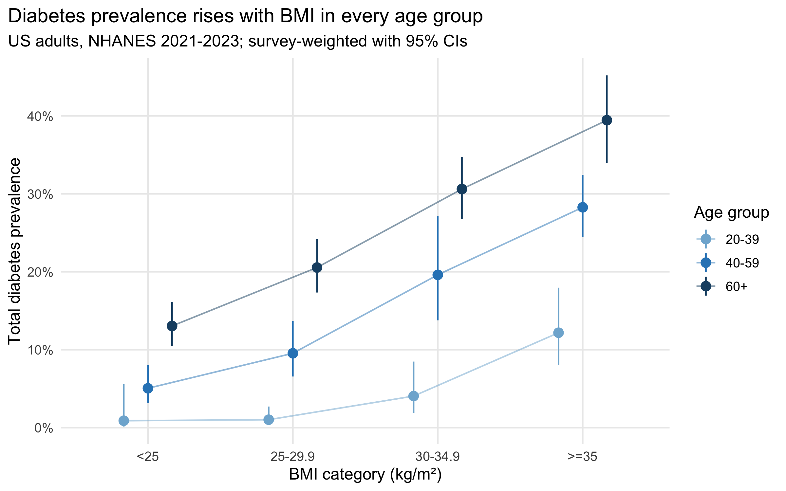
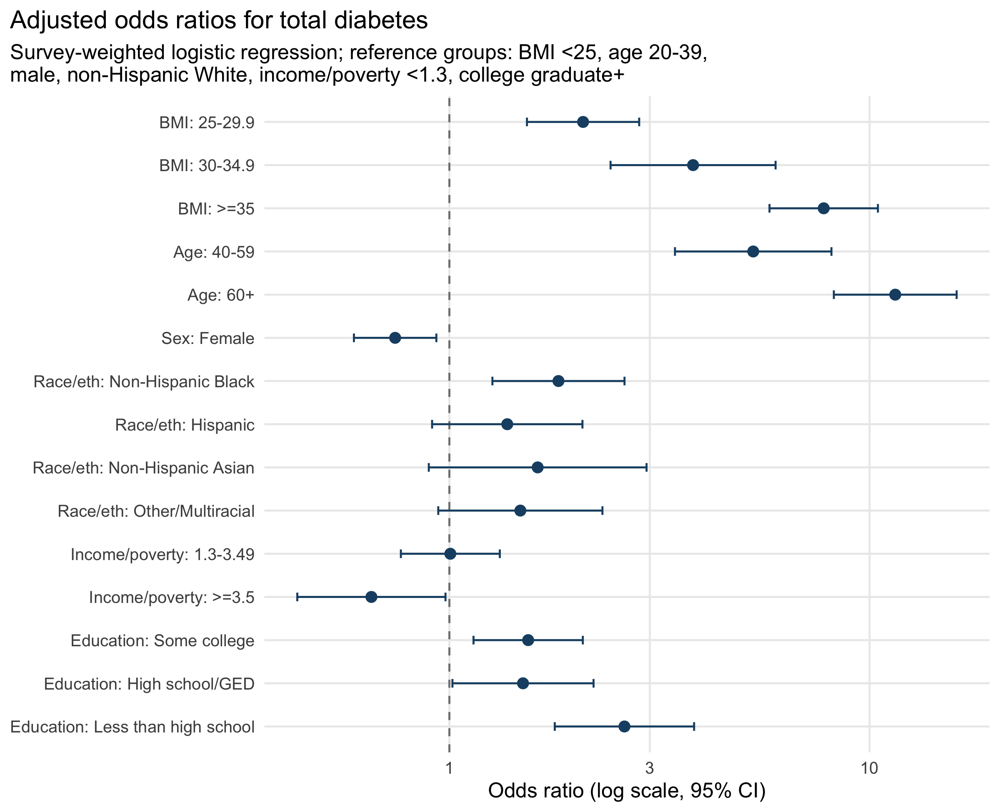
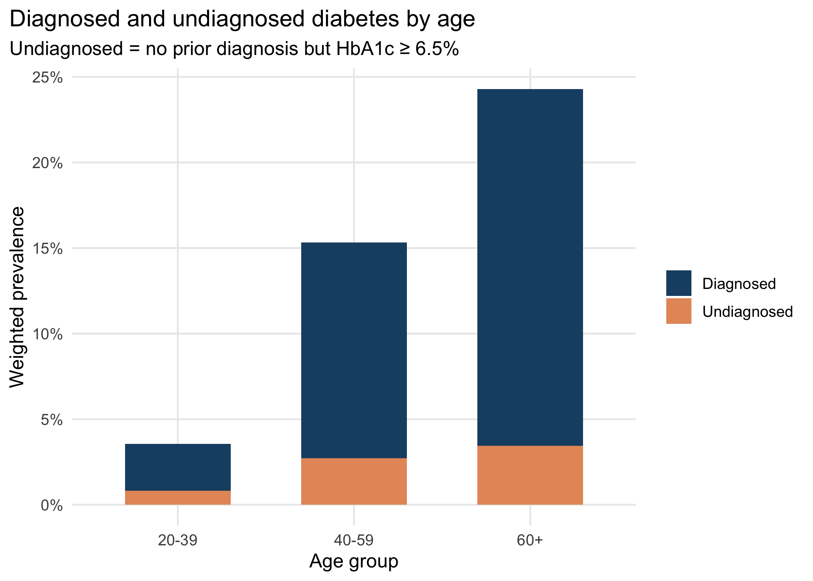

# Diabetes Prevalence and Risk Factors in US Adults (NHANES 2021–2023)

A survey-weighted analysis in R of how common diabetes is among US adults, how much of it goes undiagnosed, and which demographic, socioeconomic, and body-size factors are linked to it. Data come from the CDC's **National Health and Nutrition Examination Survey (NHANES), August 2021–August 2023**.

## Key findings

| Measure | Weighted estimate (95% CI) |
|---|---|
| Total diabetes (diagnosed + undiagnosed) | **14.0%** (12.5–15.7) |
| Diagnosed diabetes | 11.8% (10.3–13.4) |
| Undiagnosed diabetes (HbA1c ≥ 6.5%, no prior diagnosis) | 2.3% (1.8–2.8) |
| Share of all diabetes that is undiagnosed | **16.2%** (13.0–20.1) |

- **About 1 in 7 US adults has diabetes, and about 1 in 6 of those cases is undiagnosed.**
- **BMI has a strong dose-response relationship with diabetes.** After adjusting for age, sex, race/ethnicity, income, and education, adults with BMI ≥ 35 had **7.8 times the odds** of diabetes compared with BMI < 25 (OR 7.78, 95% CI 5.78–10.47). The joint Wald test for BMI gives F = 88.5 on 3 and 15 df, p < 0.001.
- **Age is the strongest predictor.** Adults aged 60+ had OR 11.5 (8.2–16.1) compared with ages 20–39.
- **Socioeconomic gradients remain after adjustment.** Less than a high-school education: OR 2.61 (1.78–3.82) vs. college graduates. Income ≥ 3.5× the poverty line: OR 0.65 (0.43–0.98).
- **Non-Hispanic Black adults** had higher adjusted odds than non-Hispanic White adults (OR 1.82, 1.27–2.61).
- **Ignoring the survey design overstates prevalence.** The unweighted sample prevalence is 16.9%, compared with 14.0% weighted, because NHANES deliberately oversamples older and minority adults.

### Figures







## Methods

**Data.** NHANES 2021–2023 public-use files: demographics (`DEMO_L`), glycohemoglobin (`GHB_L`), diabetes questionnaire (`DIQ_L`), and body measures (`BMX_L`). The scripts download them directly from CDC.

**Analytic sample.** Adults aged ≥ 20 who were not pregnant, were in the phlebotomy subsample with a valid HbA1c, and answered the diabetes question (**n = 5,730**). The full participant flow is in [`output/tables/sample_flow.csv`](output/tables/sample_flow.csv).

**Outcome definitions.**
- *Diagnosed diabetes:* answered "yes" to "Has a doctor ever told you that you have diabetes?" (`DIQ010`). Answers of "borderline" were coded as no.
- *Undiagnosed diabetes:* no prior diagnosis, with HbA1c ≥ 6.5% (ADA diagnostic threshold).
- *Total diabetes:* diagnosed or undiagnosed.

**Covariates.** Age group, sex, race/ethnicity (`RIDRETH3`), BMI category (WHO cut-points; obesity split at 35), family income-to-poverty ratio (< 1.3 / 1.3–3.49 / ≥ 3.5, matching SNAP eligibility cut-points), and education.

**Statistical approach.**
- **Complex survey design.** Every estimate uses the NHANES strata (`SDMVSTRA`), PSUs (`SDMVPSU`), and the **phlebotomy subsample weight (`WTPH2YR`)**, which is the correct weight because HbA1c was measured only in that subsample. The analysis uses the `survey` package with Taylor-series linearization.
- **Domain estimation.** The design object is built on *all* participants and then subset with `subset(design, ...)`. Subsetting the data frame instead would drop PSUs and understate standard errors.
- **Prevalence CIs.** Logit-transformed confidence intervals (`svyciprop(method = "logit")`), which stay inside [0, 1] for low prevalences.
- **Regression.** Survey-weighted logistic regression (`svyglm`, quasibinomial family), shown both unadjusted and fully adjusted. The adjusted model is a complete-case analysis (n = 4,926; most missing data comes from the income-to-poverty ratio).
- **Degrees of freedom.** The 2021–2023 cycle has 30 PSUs in 15 strata, which gives **15 design degrees of freedom**. `svyglm`'s default residual df subtracts the number of model parameters (14), leaving essentially zero df and undefined t-intervals. Following NCHS analytic guidance, CIs, p-values, and the Wald test use the **design df (15)**.
- **Discrimination.** The adjusted model has an unweighted AUC of 0.78. This is only a diagnostic: the model is meant for inference, not prediction.

## Limitations

- **Cross-sectional data**, so the associations are not causal. Reverse causation is also possible, for example weight change after a diagnosis.
- **HbA1c alone** is used to find undiagnosed cases. CDC's official estimates also use fasting plasma glucose, which is available only for the fasting subsample, so these figures likely *underestimate* total diabetes slightly. CDC reports about 15.8% for the same cycle.
- **Self-reported diagnosis** may be misclassified. Type 1 and type 2 diabetes are not distinguished.
- **Complete-case regression** assumes income and education are missing at random given the other covariates. Multiple imputation would be a natural extension.
- **Few PSUs** (15 design df) make the variance estimates fairly imprecise, especially for smaller subgroups such as non-Hispanic Asian adults.

## Repository structure

```
.
├── run_all.R                 # runs the full pipeline end to end
├── R/
│   ├── 00_download.R         # downloads NHANES .xpt files from CDC
│   ├── 01_clean.R            # merges files, defines outcomes/covariates
│   └── 02_analysis.R         # survey design, prevalence, regression, figures
├── data/                     # created by the scripts (git-ignored)
└── output/
    ├── figures/              # PNG figures
    └── tables/               # CSV tables (Table 1, prevalence, ORs, ...)
```

## Reproducing the analysis

Requires R ≥ 4.2.

```r
install.packages(c("survey", "dplyr", "tidyr", "ggplot2", "haven", "scales"))
```

```bash
Rscript run_all.R
```

The pipeline downloads about 5 MB from CDC and finishes in under a minute.

## Output tables

| File | Contents |
|---|---|
| `table1_characteristics.csv` | Weighted characteristics, overall and by diabetes status |
| `overall_prevalence.csv` | Weighted vs. unweighted prevalence |
| `prevalence_by_subgroup.csv` | Prevalence (95% CI) by each covariate |
| `logistic_regression_ORs.csv` | Unadjusted and adjusted odds ratios |
| `bmi_wald_test.txt` | Design-based Wald test for BMI |
| `undiagnosed_share.csv` | Proportion of diabetes that is undiagnosed |

## Data source

Centers for Disease Control and Prevention (CDC), National Center for Health Statistics (NCHS). *National Health and Nutrition Examination Survey Data, August 2021–August 2023.* Hyattsville, MD: U.S. Department of Health and Human Services. <https://wwwn.cdc.gov/nchs/nhanes/>
